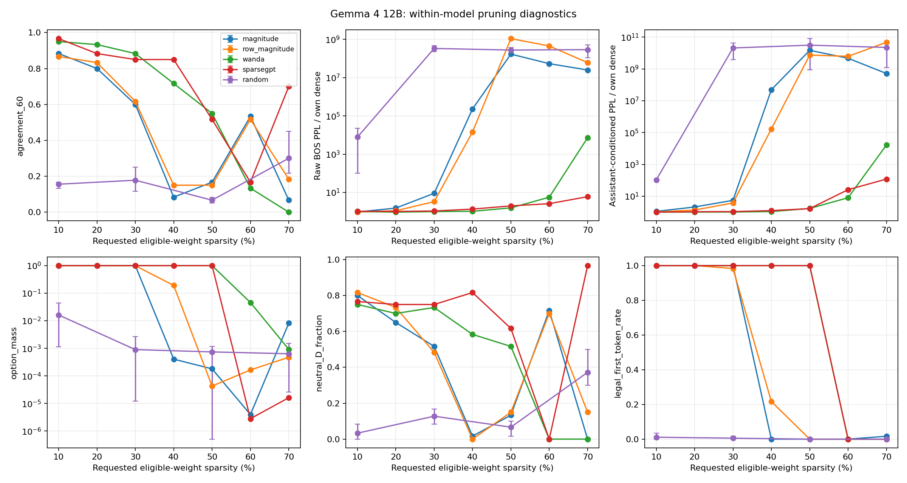

# Gemma 4-12B 静态剪枝与 MBTI（v3 扩展）

状态：2026-10-16 已完成并校验 **64/64 组**，47 项测试通过。正式矩阵于 05:48–06:08 UTC 运行；预检不计入。

结论：Gemma 的 50% 非结构化 Wanda/SparseGPT 仍能按问卷格式作答，而幅值与随机方法已严重失效；但同为 ENFJ 不代表逐题回答稳定，校准种子、结构约束和输入格式都会改变结果。

完整数据：[64 组结果](outputs/gemma4_12b_v3/RESULTS.md)、[结构/位置/种子](outputs/gemma4_12b_v3/ABLATIONS.md)、[逐题变化](outputs/gemma4_12b_v3/item_deltas.csv)、[Qwen 对照](outputs/gemma4_12b_v3/CROSS_MODEL.md)。

## 实验范围

使用 `google/gemma-4-12B-it`，固定 revision `707f0a3b8a3c7ad586ed01e27eafbad8a27dd0f7`，原生 BF16、SDPA、仅文本输入。不是 Gemma 3，也不是原论文模型列表中的同配置数值复现。

与 Qwen 对齐的是 64 组剪枝配置、60 题正文、计分键及数据来源，不是架构、参数量或 tokenizer。方法包括 magnitude、row-magnitude、random、Wanda、SparseGPT；同时比较 10–70%、drop1/2/3-of-4、模块/层段和种子。每组独立恢复原始权重。计划与修改记录见 [GEMMA_EXPERIMENT_PLAN.md](GEMMA_EXPERIMENT_PLAN.md)。

48 个 decoder 层共有 328 个可剪线性矩阵，10,899,947,520 个参数；全模型 11,959,730,176 个参数。目标权重 50% 对应全模型 45.57%，不能当成与 Qwen 相同的整体删除预算。Embedding、lm_head、norm、bias 与模态投影不剪。

## 为什么保留两套 PPL

Gemma 官方报告要求显式 BOS，但固定版本 tokenizer 不会自动加。在修正 BOS 后，原文续写损失仍较高，而原生聊天可以正常回答。对同一份 WikiText 测试数组、同一批 8,160 个预测目标做输入格式对照：

| 输入条件 | Dense PPL |
|---|---:|
| 无 BOS，仅作错误协议诊断 | 237,517.79 |
| BOS + 原始文本 | 1,552.62 |
| 固定原生 non-thinking 回答前缀 + 原始文本 | 39.49 |

32/32 个块都呈现相同改善方向。这证明输入条件影响该损失，但不能仅凭这项实验认定训练数据或架构是唯一原因。三个普通问答只是健全性检查，不是综合能力基准。

在正式 64 组矩阵中的任何剪枝组完成前，统一给全部配置增加第二种条件，保留原始指标，不选择数值更好的一种替代它；此时已经观察过用于验证适配的少量 smoke 剪枝结果。两种条件均只评分原始每块位置 1–255；BOS 或前缀到第一个原始 token 的预测不计分。原文块长 256，raw 输入长 257，assistant 输入长 280。后者的固定指令是 `Continue the following encyclopedia passage. Output only the passage.`。校准仍为 64×(BOS+256) 原始 train tokens，不使用测试数据或 assistant 前缀。

数据和前缀明细见 [input_format_controls.json](outputs/gemma4_12b_v3/input_format_controls.json)。这是 dense 诊断后调整的方案，不宣称双指标从一开始就预注册。官方 BOS 依据：[Gemma 4 技术报告 Table 11](https://arxiv.org/html/2607.02770v1)。

## 未剪枝问卷基线：`?NTJ` 不等于模型拿不准

四维硬分为 `EI=0, NS=12, FT=−4, JP=18`。60 题答案分布：A 10、B 3、C 0、D 44、E 0、F 1、G 2；49 道计分题中有 35 道 D。

E/I 的 12 题全部选中立 D，并非正负抵消。在七选项归一化分布中，这 12 题的 D 概率平均 99.65%、最低 96.63%。因此 `?` 表示计分规则没有方向，不能解读成模型对答案低置信度，也不能用仅 −0.0237 的 soft EI 分数把它强行改成 I。

相对 Qwen dense 的 ENFJ，Gemma 与其只有 23/60 道相同（计分题 19/49）。37 道差异中，33 道涉及是否选中立，4 道仅改变强度，直接正负极性反转为 0 道。例如 F/T 从 +5 到 −4，主要是中立化改变加权总和，不能直接解释成“人格由 F 变 T”。

两模型 dense 都有 60/60 合法首 token、6/6 严格单字母生成。Gemma 六个自由生成探针全为 D；这六题中有四题是 AT、不计入四字母，因此不能用这些探针代表全部维度。

## 剪枝结果与机制分析

以下讨论覆盖预先固定的全部 64 个配置，不按结果筛选方法或比例。

### 全模型目标权重 50%：标签、损失、合法性必须一起看

| 方法（默认种子） | 强制候选类型 | 与 dense 一致 | Raw PPL | Assistant PPL | 合法首 token / 生成 |
|---|---|---:|---:|---:|---:|
| Dense | ?NTJ | 60/60 | 1552.62 | 39.49 | 60/60；6/6 |
| Magnitude | ?STJ | 10/60 | 2.623×10¹¹ | 5.784×10¹¹ | 0/60；0/6 |
| Row-magnitude | INTJ | 9/60 | 1.699×10¹² | 2.925×10¹¹ | 0/60；0/6 |
| Random（seed 0） | INT? | 4/60 | 5.766×10¹¹ | 4.736×10¹¹ | 0/60；0/6 |
| Wanda | ENFJ | 33/60 | 2427.92 | 67.42 | 60/60；6/6 |
| SparseGPT | ENFJ | 31/60 | 3077.88 | 65.86 | 60/60；6/6 |

非法输出行的四字母仅是从 A–G 中强制挑最大值的结果，不作人格解释。Random 的三种子范围另见完整表，不能只凭 seed 0 代表稳定性。

Wanda/SparseGPT 明显优于同预算的纯幅值和随机掩码，但不能在两者之间宣布普适胜者：SparseGPT 的 assistant PPL 仅比 Wanda 低约 2.3%，raw PPL 却高约 26.8%；Wanda 精确答案匹配多 2 题，SparseGPT 的平均选项等级距离较小（0.767 对 0.900）。二者都改变了接近一半的答案。

多比例曲线也不是“稀疏率越高，每项指标都单调恶化”：Wanda 在 10/20/30% 的 assistant PPL 倍数约 1.005/1.008/1.020，保留 57/56/53 道答案；到 40/50% 分别变成 1.088/1.708 倍、43/33 道。低比例 raw PPL 偶尔下降，而 assistant PPL 上升，不能直接解释成能力提升。在本次网格和固定六探针上，Wanda/SparseGPT 到 50% 仍全部合法，60/70% 均失效；这是观察范围，不是普适阈值。

### Wanda 50%：为什么从 `?NTJ` 变成 ENFJ

四维分数变成 `16/17/5/14`，相对 dense 改变 `+16/+5/+9/−4`。60 题中 33 题一致、49 道计分题中 25 题一致。27 个变化分为 19 个中立状态变化（16 个 D→非 D，3 个非 D→D）与 8 个强度变化；直接正负极性反转为 0。答案分布变为 A 11、B 17、D 31、G 1。

- EI 的 +16 完全来自七个正向题从 D 改成 A/B：Q1 +2、Q11 +2、Q16 +3、Q31 +2、Q36 +3、Q43 +2、Q53 +2；五个负向题仍为 D。
- FT 的 +9 来自 Q13 A→D（+3）、Q18 D→B（+2）、Q23 A→B（+1）、Q33 B→A（+1）、Q54 D→B（+2），把 −4 推过 0 到 +5。
- soft 分数约 `15.16/14.61/4.11/15.61`，balanced 评分也为 ENFJ，因此这不是仅靠 argmax 并列或一个接近 0 的数值造成的标签抖动。

较稳妥的解释是：原本高置信度的中立回答部分被赞同替代，配合个别题强度改变，跨过了计分边界。它说明问卷响应发生变化，不证明发现了真实人格改变或“人格神经元”。此配置仍有 60/60 合法首 token、6/6 合法自由生成，选项总概率均值 0.99942；raw / assistant PPL 分别是 dense 的 1.564 / 1.708 倍。

### 同样的 ENFJ 也可能是失效假象

Wanda 70% 的强制候选答案 60 题全部为 C，由现有方向键机械得到 `ENFJ`（硬分 `2/2/3/2`）；balanced 四轴均为 0，即 `????`。但原生全词表首 token 60/60 都是字符 `1`，六条自由生成均重复数字并达到 32-token 上限，合法率均为 0。其 raw / assistant PPL 约为 dense 的 7,246 / 16,430 倍。这种 ENFJ 不属于有效的人格稳定证据。

幅值 50% 和逐行幅值 50% 也均为 0/60 合法首 token、0/6 合法生成，分别只剩 10/60、9/60 道强制候选答案一致。两者的权重相对平方扰动约 0.0606/0.0657，比 Wanda50 的 0.0912 更小，却造成更严重的输出损坏：**权重改动小不保证函数行为变化小**。这与 Wanda 通过校准激活保护输出的算法动机一致，但不是单独定位某个因果神经元的证据。

SparseGPT70 还有另一个反例：强制选项变成 D 58、G 2，得到 `??TP`，并出现 42/60 的表面答案一致。42 次匹配全部来自共同选 D，甚至低于无需读题、固定选 D 的 44/60。实际 60 个首 token 全为 `<|channel>`，六条生成循环特殊 token 到上限；过滤特殊 token 后有些显示空串，不能误写为“模型没生成”。这是强制候选评分中的中立答案塌缩，不是随稀疏率升高恢复了行为。

### SparseGPT 50% 的变化并不等同于 Wanda

SparseGPT50 的分数为 `4/6/3/7`，soft 和 balanced 也均指向 ENFJ。它主要输出 D 37、C 20、B 3；dense 从未选 C。29 个变化含 19 个中立状态变化和 10 个强度变化，没有直接正负极性反转，表现为偏向较弱赞同。六个固定生成探针仍全部 D，说明只看这些探针会漏掉大量逐题改变。

SparseGPT 的权重扰动约 0.0957，并不比 Wanda 小；但首层同一校准输入下的相对重建 MSE 为 0.001889，低于 Wanda 的 0.006049。这符合误差补偿在当前校准分布上保护层输出的预期；不能直接用后续各层不同输入上的误差来作同样的因果比较。

### 校准种子：同标签、近似损失，回答可以相差很大

| 方法 | 校准种子 0/1/2 类型 | 一致题数 | Raw PPL | Assistant PPL |
|---|---|---|---|---|
| Wanda50 | ENFJ / ENFJ / ENFJ | 33 / 16 / 13 | 2427.92 / 2066.24 / 1923.98 | 67.42 / 68.20 / 66.03 |
| SparseGPT50 | ENFJ / ENFJ / EN?J | 31 / 35 / 43 | 3077.88 / 2843.64 / 2910.09 | 65.86 / 61.37 / 68.06 |

六组都保留 60/60 合法首 token、6/6 合法生成，均没有直接正负极性反转。Wanda 的 assistant PPL 区间很窄，回答一致数却从 33 降到 13；三次 D 数为 31/13/10。SparseGPT 的 D 数为 37/36/54，第三种子的 F/T 硬分为 0，而不是得到了新的确定类型。

三个种子的平均答案一致数为 Wanda 20.67、SparseGPT 36.33，平均选项等级距离为 1.250/0.706；因此不能把默认种子下 Wanda 多两题匹配概括成“Wanda 始终更稳”。但 SparseGPT 更多中立答案也会提高对这个 D 占多数基线的匹配，不能把一致率当正确率。三个种子不足以估计可靠置信区间。

随机掩码的波动也大：仅 10% 时三个种子的 assistant PPL 已为 dense 的 82.69–122.27 倍，原文倍数 99.33–22,907.92，六探针均无合法生成；50% 三个种子只有 3–5/60 题一致。不是从某个幸运随机种子得出的失败判断。

### 结构约束：50% 置零并不是同一种干预

drop2-of-4 表示沿每行的连续四元组删除两个，与非结构化 50% 删除数量相同。在本次实现中，Wanda/SparseGPT 非结构化 50% 都保持合法生成，而 drop2-of-4 两者均变成 0/60 合法首 token、0/6 合法生成：

| 方法 | 非结构化 Assistant PPL / dense | drop2-of-4 Assistant PPL / dense | drop2-of-4 Raw PPL / dense |
|---|---:|---:|---:|
| Wanda | 1.708 | 11.679 | 12.353 |
| SparseGPT | 1.668 | 41.968 | 2.720 |

约束掩码的可选位置减少，说明仅看置零数量不足以解释影响；不能把非结构化结论直接套到可部署的结构模式。SparseGPT 在此处的 raw 指标好于 Wanda，但 assistant 指标更差且同样格式失效，仍不能单指标宣布赢家。

drop1-of-4（25%）下 Wanda/SparseGPT 的 assistant 倍数为 1.203/1.096，分别保留 50/53 题且六探针全部合法；drop3-of-4（75%）均出现常量 G 强制答案、ISTP 标签与非法生成。本矩阵没有非结构化 25%/75%，所以不作这两个比例的严格同率结构代价比较。

### 位置：保持问卷答案与保持续写损失不是同一个目标

Wanda 的 attention/MLP 局部 50% 分别保留 51/29 道答案，assistant 倍数 1.059/1.361；但二者删除预算分别约占全部可剪权重的 11.039%/38.961%，不能据此直接给两个模块作重要性排名。

层段结果更能说明指标差异：

| Wanda 层段内 50% | 类型 | 一致题数 | Raw PPL / dense | Assistant PPL / dense |
|---|---|---:|---:|---:|
| early | ENFJ | 43/60 | 1.480 | 1.023 |
| middle | ENFJ | 37/60 | 0.870 | 1.048 |
| late | ?NTJ | 54/60 | 1.724 | 1.557 |

middle/late 的参数预算完全相同，晚段问卷更接近 dense，但条件续写损失更差；不能概括成某一段对“整体能力”或“人格”普遍更重要。中段 raw PPL 下降也不代表问卷或对话能力改善。

幅值局部剪枝还说明“首 token 合法”也不充分：MLP-only 50% 的首 token 60/60 合法，但严格生成仅 4/6、答案一致仅 1/60、assistant PPL 达 671.21 倍；强制回答只剩 B 32、C 28。

### 固定掩码交互：机制依赖输入条件

对幅值方法，attention 与 MLP 单独掩码互不重叠，合并后与全剪 50% 的掩码哈希一致。按 `L(all)−L(attention)−L(MLP)+L(dense)` 计算 NLL 交互，raw 条件为 −6.326、assistant 条件为 +1.708 nats/token。负值不表示剪枝有益，all 的损失仍高于两个单模块结果。

同一权重干预的非加性效应符号随前缀条件改变，因此不能将“共同剪一定协同放大伤害”当作普适机制。该对照仅适用固定幅值掩码；Wanda 会随上游激活改变掩码，不能直接套用。明细见 [interaction_controls.json](outputs/gemma4_12b_v3/interaction_controls.json)。

## 与 Qwen 的共同点和差异

共同点是激活感知/补偿方法优于纯幅值删权重，但标签稳定远弱于逐题行为稳定。默认 50% 时，Qwen Wanda/SparseGPT 只有 28/60、12/60 道与各自 dense 一致，Gemma 为 33/60、31/60；两家的 SparseGPT 都偏向原先 dense 从未选过的弱赞同 C。

差异是 Gemma 在当前协议下对幅值 50% 的格式损伤更明显：两种幅值方法均 0/60 合法首 token、0/6 合法生成；Qwen 对应各为 59/60 和 6/6。模型大小、精度、tokenizer、原生模板及整体删除预算都不同，这不是孤立架构因素的因果证据。跨模型表只列原文 PPL 相对自身 baseline 的变化；Qwen 没有本轮 assistant 条件结果，不混合比较。

## 比较边界

- 问卷仅 60 题、49 题计分，沿用人工方向键；没有用户人类人格真值。四字母变化是本协议下的响应变化，不是心理人格测量结论。
- 常量 A/B/C 会被现有方向键打成 ENFJ，常量 E/F/G 得 ISTP；必须结合逐题差异、D 比例、原生选项质量及生成判断，不能将同类型当成保持能力。
- 两套 PPL 都是 32 个短块的条件诊断，不是完整 WikiText 基准或聊天能力测验。不同 tokenizer 的绝对 PPL 不可直接排名；相对倍数也不是跨模型综合能力排名。
- Gemma 的全局注意力 K=V，剪 k_proj 同时改变键和值；不能与 Qwen 的独立 K/V 解释成完全相同干预。
- attention/MLP 的局部 50% 分别约删全部可剪权重的 11.039%/38.961%。early/middle/late 各 16 层，但全局注意力层数是 2/3/3，删除预算约 16.613%/16.694%/16.694%，不是严格等预算。
- 随机/校准仅三个种子，范围不是置信区间；其余大部分配置只跑一次。逐层 logit lens 只在模型内解释，不跨架构比较其绝对“置信度”。
- 静态掩码应用后仍使用 dense 张量和算子，没有启用稀疏推理内核；不声称显存、速度或文件大小按置零比例改善。仓库不保存完整剪枝权重。

## 验证与复现

正式核心源码为 `81a6ca4`，协议 `3.3-gemma-dual-ppl-native-answer-logits`。47 项 CPU 测试通过，干净 Git 导出后亦全部通过；实际 BF16 权重逐块重放与原生前向检查误差为 0，dense 两项逐块 NLL 与独立格式对照完全一致。64 组的 60×49×7 logits、两项逐块损失、计分贡献守恒、提示词/源码/语料哈希及掩码计数均通过完整分析器校验。

运行命令见 [README](README.md)。Qwen 原始结果保留在 `outputs/pruning_v3/`，Gemma 另存 `outputs/gemma4_12b_v3/`。无 BOS/旧协议预检仅在本地归档，不计入 64 组；原始结果、源码、语料、提示词、掩码哈希随每组保留。
