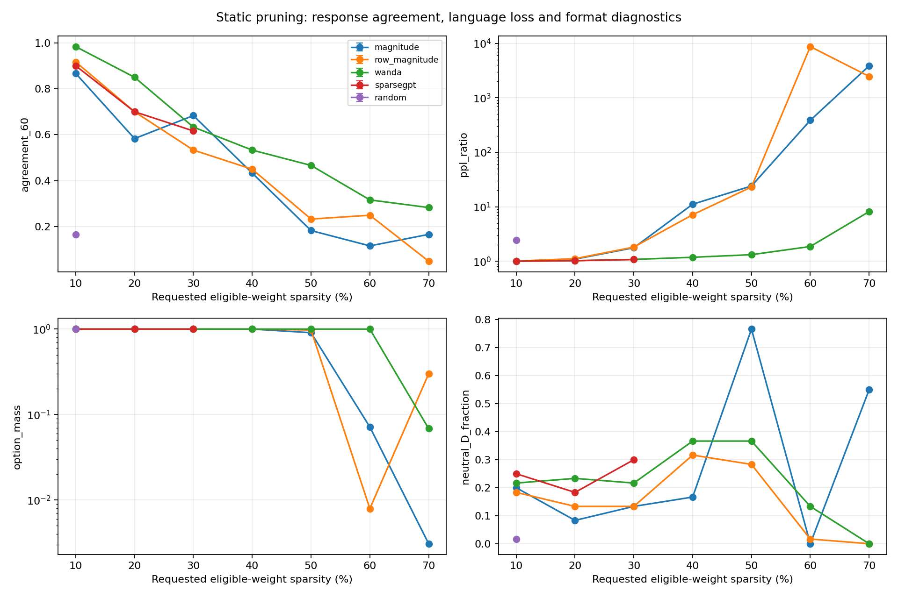
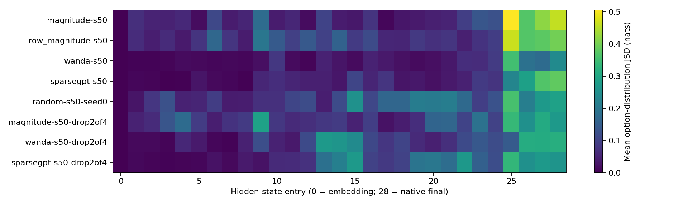

# Qwen2.5-7B 静态剪枝扩展实验

状态：**64/64 组完成并通过校验**，2026-10-14。完整预设矩阵见
[`EXPERIMENT_PLAN.md`](EXPERIMENT_PLAN.md)，完整数值见
[`RESULTS.md`](outputs/pruning_v3/RESULTS.md)，结构/位置/种子对照见
[`ABLATIONS.md`](outputs/pruning_v3/ABLATIONS.md)。原始逐题输出按配置独立保存。

## 结论摘要

- 64 个配置中有 **53 个**受限选项标签是 ENFJ，但其中包含语言建模严重受损或根本不按选项回答的配置。
  因此四字母标签远不足以评价剪枝效果。
- 非结构化 50% 时，Wanda / SparseGPT 的 test 子集 PPL 均约 **17.1**，远低于幅值剪枝约 **299–312**；
  三个校准种子中，Wanda 保留 **28–31/60** 个原答案，SparseGPT 为 **12–22/60**。
  这是本模型/题库/提示下的结果，不是跨模型方法排名。
- 变化的来源至少应区分：离散计分门槛、回答强度或选项偏置、语言/格式损伤、掩码结构约束以及模块交互。
  以下分别给出逐题算术证据、控制实验或机制解释，不把它们混成“人格变了”。
- 在同一幅值掩码拆分的 attention×MLP 对照中，联合损失额外增加 **1.6582 nats/token**，
  说明不能用单模块损伤简单相加来估计全模型剪枝影响。

## 要回答的问题

不是只问“剪枝后是否还是 ENFJ”，而是分别问：

1. 具体题目的回答和四维分数是否改变？
2. 改变是否只是 argmax/零分门槛导致的类型跳变？
3. 模型是否还在按要求回答、是否保留一般语言建模能力？
4. 方法、稀疏率、掩码结构、剪枝位置、校准样本对上述结果有何影响？

本项目测的是固定英文提示下的回答分布，不是模型拥有的人类心理属性。
Qwen2.5-7B 也不是原 MBTI 论文中的 Qwen2.5-14B/72B，因此这是方法扩展，
不是原论文表格数值的逐项复现。

## 变化来源：实测证据与解释

### 离散计分可以放大小幅分布变化

dense 的 EI/NS/FT/JP 为 **5/13/5/15**。幅值剪枝 10% 后变为 **9/6/0/9**，
于是 ENFJ 变为 EN?J。FT 的全部 -5 分变化来自第 28 题：F → A，
该题为反向计分，因此贡献变化是 `(-1) × (3 - (-2)) = -5`。

与此同时，测试 PPL 只从 **12.97** 变为 **13.04**，60/60 题的非受限首 token
仍是合法选项，不能把这个 FT 零分解释为整体语言能力崩坏。
按选项概率计算的 FT 期望分数从 **+4.19** 变为 **+2.54**，仍为正：
原协议的 argmax 计分与连续概率分数回答的是不同问题。

这组发生翻转的 8 题，其 dense 选项概率差均值约 **0.227**；另外 52 题约 **0.578**。
这是低置信度题目较敏感的描述性证据，不是每一道题的因果证明或统计显著性检验。

### 语言能力、答案一致性和类型是三个不同指标

50% 剪枝的主结果（校准种子 0；随机方法另见种子对照）：

| 方法 | 类型 | 与 dense 一致题数 | test 子集 PPL | 首 token 合法率 |
|---|---|---:|---:|---:|
| dense | ENFJ | 60/60 | 12.97 | 100% |
| 逐矩阵幅值 | EN?J | 11/60 | 311.73 | 98.3% |
| 逐行幅值 | ENFJ | 14/60 | 298.59 | 98.3% |
| Wanda | ENFJ | 28/60 | 17.11 | 100% |
| SparseGPT | ENFJ | 12/60 | 17.12 | 100% |

Wanda / SparseGPT 比这两种幅值剪枝更好地保留了该测试上的语言建模能力，
但“仍是 ENFJ”并不意味着逐题回答稳定。
逐矩阵幅值 50% 有 **46/60** 题选择 D；6 个固定自由生成探针也全部只生成 D。
逐行幅值 70% 有 **55/60** 题选择 E，虽有 96.7% 的合法首 token，PPL 却超过 3 万。
所以仅检查输出格式也不足以判断语义能力。

SparseGPT 50% 与 Wanda 的 PPL 几乎相同，但其答案中 **34/60** 是 C，而 dense 没有选 C。
“能力近似保留”不意味着保持原有回答强度与分布。精确字母一致率也会把 B→C 和 B→G
都算作不一致，因此另保存平均选项档位变化与正负极性翻转数，避免把相邻档变化与反向回答混淆。
例如 Wanda / SparseGPT 50% 的平均档位变化分别为 **1.00 / 1.22**，
从正向选项直接变成负向选项（或反之）的题数分别为 **1 / 2**；
这比单独比较 28/60 与 12/60 的精确一致率更完整。

### 小权重不等于对输出不重要

线性层扰动为 `ΔY = ΔW X`。幅值排序只关注权重大小，不能反映输入通道的激活能量。
[Wanda](https://arxiv.org/abs/2306.11695) 使用权重幅值与输入激活范数的乘积；
[SparseGPT](https://arxiv.org/abs/2301.00774) 利用二阶信息并补偿保留权重。
二者在推理前完成剪枝，掩码固定，不做梯度微调，仍属于静态剪枝。

本次 50% 逐矩阵幅值的相对权重平方扰动为 **0.06137**，Wanda 为 **0.08003**。
后者在参数空间改变更大，却得到更低的 test PPL。这与“保护激活相关输出比单纯
最小化权重改变量更重要”的机制相符，但并未定位到具体神经元或证明逐题翻转的全部因果链。
逐行幅值作为 Wanda 的粒度对照，也有助于区分“逐行分配预算”和“考虑激活”的影响。

第 0 个 transformer block 在两种校准方法下接收相同输入，其 50% 剪枝后相对输出 MSE
为 Wanda **0.04034**、SparseGPT **0.01202**。这支持 SparseGPT 的局部重建作用，
但并没有自动带来更高的 MBTI 逐题一致率。后续 block 的输入已经被前面的剪枝改变，
不能把它们的局部 MSE 不加区分地当作同输入误差比较。

### 回答趋同可以机械地产生看似明确的类型

当前题目方向标注中，EI/NS/JP 的正向/反向题数均为 **7/5**，FT 为 **8/5**。
常量回答解析对照如下：

| 所有题都选择 | 原协议给出的类型 |
|---|---|
| A、B 或 C | ENFJ |
| D | ???? |
| E、F 或 G | ISTP |

这些控制不需要模型推理，说明“存在四字母类型”不是有效人格测评的充分证据。
常量对照和正负向题分别取均值的 `balanced_*` 指标是**事后敏感性分析**，
不替换原论文求和计分，也不是经过验证的新量表。
本项目使用人工方向标注，尚未获得可核对的作者原始逐题方向键，因此不能由这个控制断言原论文 ENFJ
结果的成因；它严格适用于本项目公开的题库与人工方向标注。

### 高稀疏率下必须检查真正生成的内容

Wanda 70% 在 A–G 内强制选项仍是 ENFJ，但其合法首 token 比例为 0%。
已保存的自由生成探针出现重复自我介绍，而不是返回单个选项。
因此该配置的类型只能称作“受限选项下的标签”，不能解释成保持了有效的问卷回答。

## 结构约束：相同比例不代表相同损伤

同为删除 50% eligible 权重，加入每 4 个删 2 个的约束后：

| 方法 | 无 4 元组约束 PPL | 删除 2-of-4 PPL | 2-of-4 一致题数 | 2-of-4 合法首 token |
|---|---:|---:|---:|---:|
| 幅值 | 311.73 | 1572.33 | 19/60 | 0% |
| Wanda | 17.11 | 26.64 | 17/60 | 100% |
| SparseGPT | 17.12 | 21.82 | 23/60 | 100% |

三组 2-of-4 仍全部是 ENFJ，却具有明显不同的能力与格式表现。
结构约束限制了“哪些权重可以保留”，不能只按相同名义比例推断效果。
删除 1-of-4（25%）、3-of-4（75%）也均已纳入对照，详见
[`ABLATIONS.md`](outputs/pruning_v3/ABLATIONS.md)。这不是实际稀疏内核性能测试。

## 剪枝位置与模块交互

幅值剪枝在选中位置内删除 50%：

| 位置 | 占全部 eligible 权重的实际稀疏率 | 类型 | PPL |
|---|---:|---|---:|
| attention | 6.30% | ENFJ | 16.01 |
| MLP | 43.70% | ENFJ | 48.10 |
| early：0–8 层 | 16.07% | ENFJ | 22.32 |
| middle：9–17 层 | 16.07% | ENFJ | 14.58 |
| late：18–27 层 | 17.86% | ENTJ | 245.22 |

early 与 middle 是等删除预算对照，本次 middle 的语言损伤较小。
late 同时出现 FT 变为 **-3** 和明显 PPL 损伤，但它比另两个分段多一层，
不能把差异全部归因于“层位置”而忽略预算。
Wanda 同样剪 late 时仍为 ENFJ、PPL **15.74**，说明选择准则也非常重要。
attention 与 MLP 的预算差很大，不能仅凭两行 PPL 排名哪种模块“更重要”。

可以做一个更干净的固定掩码 2×2 检验：逐模块 SHA-256 验证表明，
幅值 attention-only 与 MLP-only 掩码互不相交，二者并集恰好是 all 掩码。
在相同 test 上，用平均负对数似然 `L` 衡量：

`L(all) - L(attention) - L(MLP) + L(dense) = +1.6582 nats/token`。

因此联合损伤并非两部分损失简单相加。以 NLL 可加作参照，PPL 应约为 59.4，
而实际是 311.7。这是该固定模型/语料上的模块交互证据，不是总体显著性结论，
也没有定位到具体的门控或注意力路径。
Wanda 的掩码会随上游校准输入改变，因此不直接套用这个“同一固定掩码”的解释。

## 种子重复

随机 10% 三个种子均为 ENFJ，但 PPL 分别为 **31.55、34.65、37.59**。
随机 30/50/70% 的 9 组全部为 0% 合法首 token，虽然还会产生 ENFJ、ISTP、
`?NFP` 或 `????` 等受限标签，不应据此判断人格变化。
全部种子均保留，不按结果选择掩码。

Wanda 50% 的三种校准采样均为 ENFJ，PPL **17.11–17.23**，
逐题一致数 **28/30/31**。SparseGPT 同样均为 ENFJ，PPL **17.12–17.26**，
逐题一致数为 **12/22/16**。两种方法的 PPL 对这些校准采样较稳定，
但逐题结果仍有敏感性，尤其不能以一个种子的答案一致率概括全部表现。
本次三种种子下 Wanda 的精确答案一致率均高于 SparseGPT，
但在 2-of-4 的单种子对照中，SparseGPT 的 PPL 和答案一致数反而更好。
应结合目标和结构约束选择方法，而非宣布单一全局赢家。

图中随机方法为三个种子的均值，误差棒是最小–最大范围，不是置信区间。

## 完整性与复现验证

- 64 组均从原始 dense 权重独立开始，未累积剪枝；共 **3,840** 次逐题评估、
  **384** 段固定自由生成探针，PPL 共覆盖 **522,240** 个预测目标（同一 test 子集重复用于各模型）。
- 每组 `results.npz` 为 60×29×7、float32、全部有限值；从 logits 回算答案、类型和逐题分数贡献全部一致。
- 所有题的 native logits / 最终隐藏状态输出头投影最大差为 **0**；没有重现旧版末层重复归一化问题。
- **15 项测试通过**：计分零分、投影、精确掩码、半结构化计数、SparseGPT 补偿、
  block 输入捕获、旧新幅值实现一致性、未剪参数保护、JSD 和常量回答控制等。
- 模型 revision、软件版本、核心源码/题库/校准数据 SHA-256、逐模块掩码 SHA-256 均保留。
  校准和 test 分离，不使用 MBTI 题目或答案做校准。
- 主运行完成标记：`logs/pruning_v3/parallel_driver.log` 中
  `ALL_PRUNING_RUNS_VERIFIED_AND_ANALYZED 2026-10-14T08:29:45Z`。

## 固定边界

- 使用 60 题；49 题进入四维计分，11 个 A/T 条目不进入类型。
- 校准为 WikiText-2 raw train 的 64×256 tokens，test 为独立 test split 的
  32×256-token 块、8,160 个预测目标。这是短上下文子集诊断，不是完整标准 PPL。
- 6 个固定自由生成探针只作补充诊断，不代表完整生成评测；首 token 不合法本身
  也不等价于整个回复无效，需结合生成原文判断。
- 局部 scope 消融的删除参数预算不同，不能当作等预算优劣排名。
- 只覆盖一个模型、一套英文题库与提示；没有选项字母换序、提示改写或跨模型验证。
  不能把回答分布变化直接等同于稳定的人格属性变化，也不能从 3 个种子推断人群置信区间。
- 未微调、未使用稀疏存储或稀疏推理内核，不宣称实际模型文件/显存减少或速度提升。
- 不同方法耗时受同卡并行任务影响，不作硬件速度基准。
- 精确字母一致率以 dense 为参照，不是正确率；另提供 49 道计分题的一致率。
  选项概率沿用原协议的“同一选项不同 token 拼写取最大 logit，再在七项内归一化”。
  全词表选项总概率质量另行计算，不与七项内归一化概率混淆。
- 逐层 JSD 是 logit-lens 描述性诊断；中间层置信度变化会影响它，峰值位置
  不能直接视为造成类型变化的因果层。
- 选项最大 logit 完全并列时按 A–G 顺序取首项（dense 有 2 题）；这与维度零分记 `?`
  是不同的规则。CSV 记录并列数，不把并列题视为强偏好。
- v2 与 v3 的 dense、幅值 50%、2-of-4 幅值三组均为 60/60 最终答案一致；
  原始 FP16 logits 最大绝对差分别约 0.094 / 0.125 / 0.086，不承诺跨运行逐 bit 相同。
- 本次未保存 64 份完整 FP16 权重；代码、种子、校准抽样、权重 revision、掩码哈希
  和原始测评输出均保留，可按配置重建。上一轮两个剪枝 checkpoint 仍在本机保存。

## 文件

- [`comparison.csv`](outputs/pruning_v3/comparison.csv)：每配置指标，包括硬分数、概率期望分数和计分敏感性。
- [`item_deltas.csv`](outputs/pruning_v3/item_deltas.csv)：逐题翻转及对维度分数的精确贡献。
- [`analysis.json`](outputs/pruning_v3/analysis.json)：分层 JSD、生成原文、局部重建误差。
- [`response_controls.json`](outputs/pruning_v3/response_controls.json)：题目方向计数与常量回答控制。
- [`interaction_controls.json`](outputs/pruning_v3/interaction_controls.json)：掩码一致性及 attention×MLP 交互计算。
- [`repeat_controls.json`](outputs/pruning_v3/repeat_controls.json)：与上一轮三个对应配置的数值/答案回归对照。
- 每个配置的 `summary.json` / `results.npz`：原始结果、实际稀疏率、溯源信息及 60×29×7 logits。
