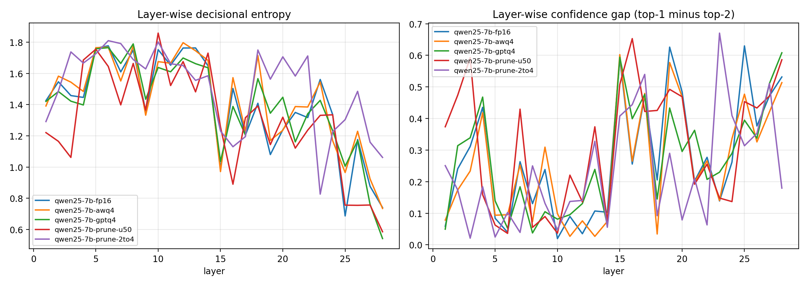

# Qwen2.5-7B MBTI、量化与静态剪枝：修正后重跑报告

日期：2026-10-14。协议版本：`2.0-native-final-logits`。工作目录：`/NFS/T5/kailais/SWM/MBTI`。

**本报告取代 2026-10-13 的首轮结论。** 首轮代码对末层隐藏状态重复归一化，且维度零分默认选第一极。
本次修复后，五个变体均完成 60 题评测，两份剪枝模型完成保存、重新加载及 60 题复测。
FP16/AWQ 的标签为 ENFJ；GPTQ 和非结构化剪枝的 F/T 维度并列，标为 EN?J。
2:4 的强制选项标签虽为 ENFJ，但不限制词表时 60 题首 token 均为 `Based`，
选项概率总量极低，不能据此声称剪枝保留了人格行为。

## 1. 修复与优化

- **末层**：直接使用 `out.logits[:, -1, :]`。本机 Qwen2 实现的最后隐藏状态已经过 final norm，
  因此不能再次应用 norm。每题额外检查 `lm_head(last_hidden_state)` 与原生 logits 一致，
  本次五组的最大绝对差均为 **0**。
- **中间层**：embedding 和中间 transformer 状态经一次 final norm 后，只计算选项对应的输出头行。
  避免为每层投影全部词表，也避免逐 token 调用 `.item()` 同步 GPU。
- **最后位置推理**：使用 `logits_to_keep=1`；单题、无采样，保留原来的 A–G 选项和提示词。
- **并列分数**：某维度得分为 0 时用 `?` 表示未定，摘要中 `pole=null, tie=true`；
  不再默认为 E/N/F/J。
- **剪枝**：非结构化剪枝按每个矩阵精确选择 50% 元素；阈值相同按展平索引处理。
  2:4 采用稳定排序，每行连续四元素剪掉最小的两个。原非结构化实现实测约 50.101%，新实现正好 50%。
- **保存与溯源**：logits 以 float32 保存；固定模型 revision，记录软件版本、源码/题库 SHA-256、
  GPU 和输出诊断。结果目录禁止覆盖；一键脚本仅复用协议、源码哈希匹配的完整结果，失败返回非零状态。
- **剪枝 checkpoint**：保存 config、tokenizer、权重和剪枝清单；重新加载后验证全部 60 题、
  全部 29×7 层选项 logits，重载前后最大绝对差均为 **0**。

实现与输出语义参考 [Hugging Face Qwen2](https://huggingface.co/docs/transformers/model_doc/qwen2)
和 [Model outputs](https://huggingface.co/docs/transformers/main_classes/output)，并对照本机
`transformers/models/qwen2/modeling_qwen2.py` 与 `utils/output_capturing.py`。
核心回归测试见 [tests/test_protocol.py](tests/test_protocol.py)。

## 2. 实验范围与计分

依据 [When Personality Meets Quantization（arXiv:2608.25977v2）](https://arxiv.org/html/2608.25977v2)
的无条件 MBTI 流程；原文存档在 `docs/`。本次模型为 **Qwen2.5-7B-Instruct**，
不是论文的 Qwen2.5-14B/72B，不能称作原论文表格的逐项数值复现。

- 60 题，逐题独立提示；不采样、不重训、不校准。
- A–G 映射到 +3、+2、+1、0、−1、−2、−3；乘人工标注方向后按维度求和。
- EI/NS/JP 各 12 题，FT 13 题；合计 **49 题**决定四字母标签。
  另有 11 题 AT，不参与四维计分，但仍参与 60 题平均熵、置信差和整体一致率。
- 七选项的分数取裸字母和带空格字母对应 token logits 的最大值；选项内重新 softmax。
  此分布是受选项集合限制的分布，不等同于模型完整词表中的输出概率。
- H 为自然对数 Shannon 熵，G 为选项内 top-1 减 top-2 概率；均跨题取平均。
- 正分对应 E/N/F/J，负分对应 I/S/T/P。零分未定；`EN?J` 的候选为 ENFJ 或 ENTJ，
  并非新增 MBTI 类型。

源码：[mbti_common.py](src/mbti_common.py)、[run_experiment.py](src/run_experiment.py)。
完整题库和方向：[mbti_items.json](data/mbti_items.json)。

## 3. 修正后的结果

一致率均相对**本次修正版 FP16**。所有标签是 A–G 强制选项下的聚合标签。

| 变体 | 标签 | EI / NS / FT / JP | 60 题一致率 | 计分题一致率 | 末层 H | 末层 G |
|---|---|---|---|---|---|---|
| FP16 | ENFJ | 5 / 13 / 5 / 15 | 60/60 (100.0%) | 49/49 | 0.740 | 0.532 |
| AWQ-INT4 | ENFJ | 8 / 6 / 8 / 20 | 42/60 (70.0%) | 34/49 | 0.734 | 0.514 |
| GPTQ-INT4 | EN?J | 5 / 18 / 0 / 10 | 23/60 (38.3%) | 20/49 | 0.541 | 0.608 |
| 非结构化剪枝 50% | EN?J | 11 / 4 / 0 / 3 | 11/60 (18.3%) | 8/49 | 0.585 | 0.586 |
| 2:4 剪枝 50% | ENFJ | 2 / 20 / 8 / 5 | 19/60 (31.7%) | 19/49 | 1.062 | 0.180 |

原始数据与机器可读汇总：
[summary_table.md](outputs/corrected_v2/summary_table.md)、
[comparison.json](outputs/corrected_v2/comparison.json)、
[per_item_choices.csv](outputs/corrected_v2/per_item_choices.csv)。

### 自由下一 token 诊断

对同一次前向的完整词表分布做诊断。这里的“合法”只指**第一 token**为选项 token，
没有生成多 token 回答，也没有将其当作通用语言能力评测。

| 变体 | 完整词表 top-1 为选项 | 合法选项 token 的平均总概率 |
|---|---|---|
| FP16 | 60/60 | 100.0000% |
| AWQ-INT4 | 60/60 | 100.0000% |
| GPTQ-INT4 | 60/60 | 100.0000% |
| 非结构化剪枝 50% | 59/60 | 90.9697% |
| 2:4 剪枝 50% | 0/60 | 0.0019% |

- 非结构化剪枝的首 token 有 **46/60 为 D（中立）**，FP16 为 13/60。
  虽然多数题仍输出合法选项，回答分布已明显变化。
- 2:4 剪枝的完整词表 top-1 在 **60/60 题均为 `Based`**，
  A–G token 平均概率总量仅约 **0.0019%**。
  强制在极小的选项概率中重归一化仍会产生 ENFJ 标签，但该标签不足以证明行为保持正常。
- 本次未做 PPL、语言任务基准或多轮对话，不能把首 token 格式失败直接等同于全面语言能力丧失。

### 逐层曲线

[PNG](outputs/corrected_v2/layer_curves.png) /
[SVG](outputs/corrected_v2/layer_curves.svg)。

本次 AWQ 的最终标签、末层 H/G 与基线接近，但逐题一致率仅 70%；
GPTQ 的标签出现 F/T 并列、逐题一致率约 38.3%。
非结构化剪枝和 2:4 的逐题一致率分别为 18.3% 与 31.7%。
2:4 的末层 H 更高、G 更低；结合其选项概率极低，不能只用这张图解读“人格决策”。
这些观察仅针对当前模型、提示词、计分和压缩方案，不能推广成量化与剪枝的普遍优劣。

## 4. 与旧结果的区别

“历史回答改变”比较旧存档与本次回答；“同次前向双 norm 影响”在本次权重、
同一次前向中分别计算正确末层 logits 和旧双 norm 公式，单独观察该错误的影响。

| 变体 | 旧标签 → 新标签 | 历史回答改变 | 同次前向双 norm 影响 |
|---|---|---|---|
| FP16 | ENFJ → ENFJ | 15/60 | 16/60 |
| AWQ-INT4 | ENFJ → ENFJ | 16/60 | 16/60 |
| GPTQ-INT4 | ENFJ → EN?J | 5/60 | 5/60 |
| 非结构化剪枝 50% | ENFJ → EN?J | 7/60 | 3/60 |
| 2:4 剪枝 50% | ENFJ → ENFJ | 24/60 | 20/60 |

历史比较还混有剪枝数量/并列权重处理及执行数值路径变化，不能把所有历史差异都归因于双 norm。
因此同时保留了 `legacy_final_logits` 和
`legacy_double_norm_on_same_weights` 诊断；旧结果完整保留，没有覆盖。

旧报告中“同为 50% 压缩强度”“全部保持 ENFJ”“首次在剪枝上验证”等表述已撤回：
前者把位宽和稀疏率混为一谈，后两者超出了现有证据。

## 5. 剪枝对象、存储与环境

剪枝覆盖 transformer 中的 196 个线性层，不剪 lm_head、embedding、norm 和 bias。
每份模型总参数为 **7,615,616,512**；
目标线性权重共 **6,525,288,448**，
置零 **3,262,644,224**，占目标权重 50%，占全模型参数约 **42.84%**。
逐层统计保存在各结果的 `prune.per_layer` 和 checkpoint 的 `pruning_manifest.json` 中。

**置零不等于存储压缩或提速。** 两种剪枝模型均以原尺寸稠密 FP16 张量保存，每份权重约
15.23 GB（14.19 GiB）；未转换为稀疏存储，未启用稀疏计算内核，也未测吞吐。
FP16→4-bit 的理论权重位宽变化为 16→4，忽略元数据时约减少 75% 权重位数，
与剪掉一半元素不是等预算对照。

权重真实位置为本机持久盘，项目下保留符号链接：

- [非结构化剪枝模型](checkpoints/corrected_v2/qwen25-7b-prune-u50) →
  `/home/kailais/mbti_checkpoints/corrected_v2/qwen25-7b-prune-u50/`
- [2:4 剪枝模型](checkpoints/corrected_v2/qwen25-7b-prune-2to4) →
  `/home/kailais/mbti_checkpoints/corrected_v2/qwen25-7b-prune-2to4/`

如迁移到另一台机器，需要同时拷贝链接目标，不能只拷贝项目目录中的链接。

软件：Python 3.10.21、torch 2.14.1（运行时 +cu130）、transformers 5.19.0、
accelerate 1.15.0、gptqmodel 7.6.0、autoawq 0.2.9、optimum 2.3.0。
完整版本快照：[environment.freeze.txt](outputs/corrected_v2/environment.freeze.txt)；
它是本机版本记录，不是带 wheel 哈希和平台约束的跨平台锁文件。
设备：H200，dense/剪枝使用 GPU 7，AWQ 使用 GPU 1，GPTQ 使用 GPU 3。
模型来自本地 HF 缓存，未调用计费 LLM API。

| 模型 | 固定 revision |
|---|---|
| FP16 | `null` |
| GPTQ-INT4 | `null` |
| AWQ-INT4 | `null` |

## 6. 验证、运行记录与文件交接

- 5 项回归测试全部通过：[测试日志](logs/corrected_v2_tests.log)。
- 5 组 × 60 题，保存的 float32 logits 均为 `(60, 29, 7)` 且无非有限值。
- 汇总脚本重新核算每题选项、维度分数、标签、H/G，全部与保存摘要一致。
- 原生末层投影校验最大绝对差均为 0。
- 两份剪枝模型各重新加载复测 60 题，选项与全部层 logits 一致，最大绝对差均为 0。
- 各摘要的题库/核心源码哈希已核对，剪枝每层实际零元素数等于精确掩码数。

本次首次启动遇到 CUDA 显存统计初始化顺序错误，已修复并保留
`logs/corrected_v2_startup_failure/`。第一次向 NFS 写 checkpoint 时出现严重写入等待，
仅终止了本项目该次保存进程，改存本机持久盘并重跑剪枝。
未完成的 NFS 分片保留在 `archive/aborted_nfs_checkpoint_u50_20261014/`，不可作为可用模型。
最终完成日志：[corrected_v2_driver.log](logs/corrected_v2_driver.log)。

| 内容 | 路径 |
|---|---|
| 本报告 / 操作说明 | `REPORT.md` / `README.md` |
| 修正版每变体摘要与 logits | `outputs/corrected_v2/<tag>/summary.json`、`results.npz` |
| 汇总 / 逐题表 / 图 | `outputs/corrected_v2/` |
| 剪枝模型和重载记录 | `checkpoints/corrected_v2/` 链接、结果摘要 `checkpoint` 字段 |
| 各变体日志 | `logs/corrected_v2/` |
| 原论文存档 | `docs/arxiv_2608.25977_paper.html`、`.txt` |
| 修改前完整备份 | `archive/pre_fix_20261014_yoD34B/` |
| 旧结果（仅供审计） | `outputs/` 根下五个原变体目录 |

复跑与加载命令见 [README.md](README.md)。条件化 prompting、UALD、2-bit 和 PPL
仍未运行；它们不属于本次已完成的五变体修正重跑。
