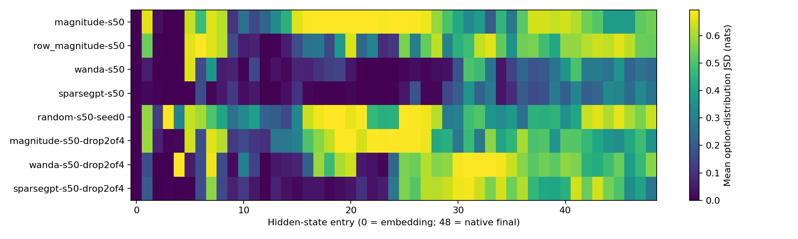
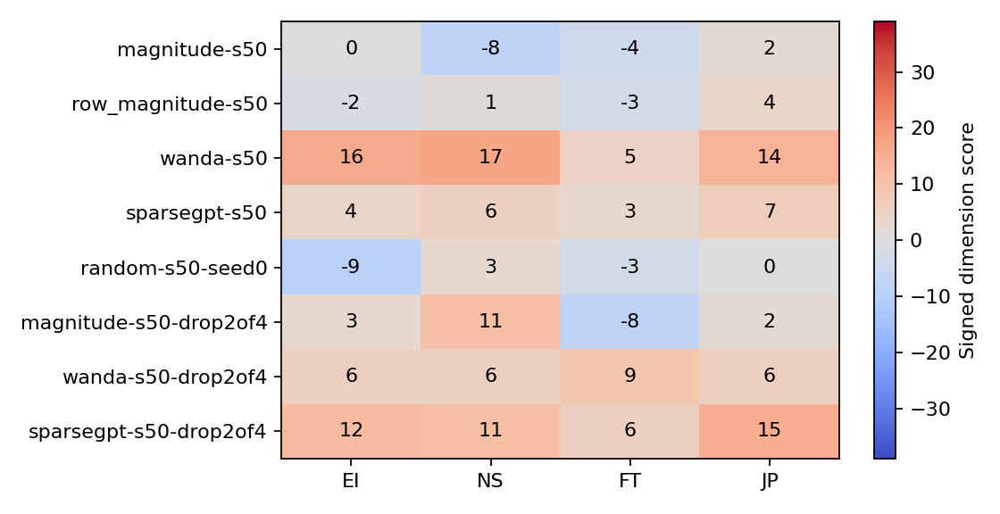

# Gemma 4 12B 静态剪枝：完整结果表

已验证 64/64 组。全部完成。

仅文本输入、语言层静态剪枝；模型版本、语料哈希、掩码哈希保存在每组 summary.json。
PPL 为 WikiText-2 test 开头 32 × 256 原始 token 短上下文子集；每段显式前置 BOS（ID 2），模型输入长度 257。
只评分原始 token 的位置 1–255（logits[1:-1] 对齐 raw_tokens[1:]），不评分 BOS→首个原始 token；共 8,160 个预测位置，不是完整基准。原始语料文件未修改，校准输入同样前置 BOS。
所有 64 组另测 Assistant PPL：仅将同一批测试原文放在固定原生非思考 assistant 前缀之后，仍评分完全相同的 8,160 个原始目标。前缀不计分，不改变原文 BOS 校准；文本/IDs/哈希保存在 assistant_language_eval。
两种 PPL 倍数分别相对同一条件下的 dense 基线，不能交叉作分母。Assistant PPL 是前缀条件敏感性诊断，不是标准基准、对话正确率或跨模型公平排名。
一致率相对 Gemma 自身 dense 回答，不是正确率或真实人格保持率；零分 `?` 表示未确定方向。
自由生成只有 6 个固定探针。原生回答位置的首 token 合法率与整段自由生成是不同诊断。

| 配置 | 类型 | EI/NS/FT/JP | 一致题数 | 原文 PPL | 原文倍数 | Assistant PPL | Assistant 倍数 | 合法首 token | D 比例 |
|---|---|---|---:|---:|---:|---:|---:|---:|---:|
| dense-s00 | ?NTJ | 0/12/-4/18 | 60/60 | 1552.624 | 1.000 | 39.486 | 1.000 | 100.0% | 73.3% |
| magnitude-s10 | ?NTJ | 0/11/-4/12 | 53/60 | 1477.339 | 0.952 | 44.068 | 1.116 | 100.0% | 80.0% |
| magnitude-s20 | ENFJ | 4/11/1/17 | 48/60 | 2365.689 | 1.524 | 83.383 | 2.112 | 100.0% | 65.0% |
| magnitude-s30 | ENFJ | 18/15/15/21 | 36/60 | 13967.242 | 8.996 | 217.639 | 5.512 | 100.0% | 51.7% |
| magnitude-s40 | INFP | -6/3/1/-10 | 5/60 | 359457133.322 | 231515.849 | 1942164881.413 | 49185561.544 | 0.0% | 1.7% |
| magnitude-s50 | ?STJ | 0/-8/-4/2 | 10/60 | 262255176598.916 | 168910905.224 | 578354178968.774 | 14646889837.344 | 0.0% | 13.3% |
| magnitude-s60 | IST? | -3/-2/-6/0 | 32/60 | 83426567581.044 | 53732617.341 | 184305001770.060 | 4667546558.081 | 0.0% | 71.7% |
| magnitude-s70 | ENFP | 10/10/7/-2 | 4/60 | 38762782023.972 | 24965976.594 | 20320151140.930 | 514610296.013 | 1.7% | 0.0% |
| row_magnitude-s10 | ?NTJ | 0/11/-3/15 | 52/60 | 1466.808 | 0.945 | 40.520 | 1.026 | 100.0% | 81.7% |
| row_magnitude-s20 | ENFJ | 3/10/3/17 | 50/60 | 1725.820 | 1.112 | 53.612 | 1.358 | 100.0% | 73.3% |
| row_magnitude-s30 | ENFJ | 11/11/11/20 | 37/60 | 5106.991 | 3.289 | 149.373 | 3.783 | 98.3% | 48.3% |
| row_magnitude-s40 | ENFJ | 8/13/8/6 | 9/60 | 22490556.391 | 14485.511 | 6664012.188 | 168766.918 | 21.7% | 0.0% |
| row_magnitude-s50 | INTJ | -2/1/-3/4 | 9/60 | 1699157733504.993 | 1094377905.542 | 292470285813.378 | 7406845515.741 | 0.0% | 15.0% |
| row_magnitude-s60 | ESFP | 3/-1/1/-3 | 31/60 | 698115357809.750 | 449635727.185 | 242798734943.679 | 6148907456.167 | 0.0% | 70.0% |
| row_magnitude-s70 | ENFJ | 6/7/1/3 | 11/60 | 94071266589.310 | 60588557.302 | 1847771391643.452 | 46795034949.439 | 0.0% | 15.0% |
| wanda-s10 | ?NTJ | 0/10/-4/18 | 57/60 | 1570.356 | 1.011 | 39.703 | 1.005 | 100.0% | 75.0% |
| wanda-s20 | ?NTJ | 0/13/-4/18 | 56/60 | 1454.447 | 0.937 | 39.813 | 1.008 | 100.0% | 70.0% |
| wanda-s30 | ?NTJ | 0/11/-1/19 | 53/60 | 1550.074 | 0.998 | 40.293 | 1.020 | 100.0% | 73.3% |
| wanda-s40 | EN?J | 9/12/0/19 | 43/60 | 1606.820 | 1.035 | 42.946 | 1.088 | 100.0% | 58.3% |
| wanda-s50 | ENFJ | 16/17/5/14 | 33/60 | 2427.916 | 1.564 | 67.424 | 1.708 | 100.0% | 51.7% |
| wanda-s60 | ?SF? | 0/-12/15/0 | 8/60 | 8734.043 | 5.625 | 317.246 | 8.034 | 0.0% | 0.0% |
| wanda-s70 | ENFJ | 2/2/3/2 | 0/60 | 11250288.894 | 7245.983 | 648781.890 | 16430.480 | 0.0% | 0.0% |
| sparsegpt-s10 | ?NTJ | 0/10/-4/18 | 58/60 | 1613.539 | 1.039 | 39.601 | 1.003 | 100.0% | 76.7% |
| sparsegpt-s20 | ?NTJ | 0/10/-1/16 | 53/60 | 1581.737 | 1.019 | 41.995 | 1.064 | 100.0% | 75.0% |
| sparsegpt-s30 | ?NTJ | 0/11/-3/20 | 51/60 | 1666.678 | 1.073 | 42.883 | 1.086 | 100.0% | 75.0% |
| sparsegpt-s40 | ENTJ | 3/6/-1/14 | 51/60 | 2096.255 | 1.350 | 49.314 | 1.249 | 100.0% | 81.7% |
| sparsegpt-s50 | ENFJ | 4/6/3/7 | 31/60 | 3077.878 | 1.982 | 65.858 | 1.668 | 100.0% | 61.7% |
| sparsegpt-s60 | ENFJ | 6/6/9/6 | 10/60 | 4025.288 | 2.593 | 1020.950 | 25.856 | 0.0% | 0.0% |
| sparsegpt-s70 | ??TP | 0/0/-3/-3 | 42/60 | 9297.057 | 5.988 | 4707.746 | 119.224 | 0.0% | 96.7% |
| random-s10-seed0 | ENFP | 6/6/9/-2 | 8/60 | 712148.541 | 458.674 | 4828.128 | 122.273 | 0.0% | 1.7% |
| random-s10-seed1 | ENFJ | 6/6/9/6 | 10/60 | 35567387.853 | 22907.916 | 3265.057 | 82.688 | 3.3% | 0.0% |
| random-s10-seed2 | ESFP | 2/-6/5/-1 | 10/60 | 154221.654 | 99.330 | 4501.877 | 114.011 | 0.0% | 8.3% |
| random-s30-seed0 | ?S?J | 0/-6/0/2 | 7/60 | 720207402215.842 | 463864568.222 | 151819743913.810 | 3844853456.759 | 0.0% | 13.3% |
| random-s30-seed1 | INFJ | -12/2/5/4 | 10/60 | 349375438923.069 | 225022523.546 | 1686058088296.492 | 42699625898.225 | 0.0% | 16.7% |
| random-s30-seed2 | ?NFJ | 0/2/1/11 | 15/60 | 489371463544.932 | 315189877.164 | 601609702204.069 | 15235838788.218 | 1.7% | 8.3% |
| random-s50-seed0 | INT? | -9/3/-3/0 | 4/60 | 576605516598.947 | 371374784.775 | 473607783767.693 | 11994174654.920 | 0.0% | 1.7% |
| random-s50-seed1 | ESFP | 7/-3/7/-6 | 3/60 | 467797251888.651 | 301294557.089 | 3159921836739.375 | 80025404363.576 | 0.0% | 10.0% |
| random-s50-seed2 | ?SFP | 0/-1/6/-1 | 5/60 | 239967211958.797 | 154555877.682 | 34742458820.631 | 879856989.936 | 0.0% | 8.3% |
| random-s70-seed0 | ENTP | 3/11/-7/-3 | 27/60 | 169510856801.920 | 109176995.623 | 2086547886450.671 | 52842078685.553 | 0.0% | 50.0% |
| random-s70-seed1 | ?NTP | 0/12/-1/-2 | 13/60 | 371629124465.300 | 239355472.921 | 49138806455.266 | 1244446242.564 | 0.0% | 31.7% |
| random-s70-seed2 | EN?P | 2/4/0/-3 | 14/60 | 808348282914.531 | 520633537.052 | 499354463824.582 | 12646212454.911 | 0.0% | 30.0% |
| magnitude-s25-drop1of4 | ENFJ | 3/12/6/16 | 46/60 | 13284.850 | 8.556 | 182.120 | 4.612 | 98.3% | 68.3% |
| magnitude-s50-drop2of4 | ENTJ | 3/11/-8/2 | 24/60 | 410448012251.369 | 264357585.599 | 508166495984.600 | 12869378239.796 | 0.0% | 48.3% |
| magnitude-s75-drop3of4 | ESF? | 3/-3/8/0 | 4/60 | 173327895929.321 | 111635439.123 | 140793014211.853 | 3565600187.597 | 1.7% | 6.7% |
| wanda-s25-drop1of4 | ENTJ | 8/10/-3/18 | 50/60 | 2094.673 | 1.349 | 47.487 | 1.203 | 100.0% | 68.3% |
| wanda-s50-drop2of4 | ENFJ | 6/6/9/6 | 10/60 | 19180.298 | 12.353 | 461.145 | 11.679 | 0.0% | 0.0% |
| wanda-s75-drop3of4 | ISTP | -6/-6/-9/-6 | 2/60 | 6971875743827.365 | 4490381689.574 | 10098599903604.650 | 255748269275.492 | 0.0% | 0.0% |
| sparsegpt-s25-drop1of4 | ?NTJ | 0/4/-3/18 | 53/60 | 1782.061 | 1.148 | 43.292 | 1.096 | 100.0% | 78.3% |
| sparsegpt-s50-drop2of4 | ENFJ | 12/11/6/15 | 32/60 | 4222.696 | 2.720 | 1657.158 | 41.968 | 0.0% | 53.3% |
| sparsegpt-s75-drop3of4 | ISTP | -6/-6/-9/-6 | 2/60 | 21267.349 | 13.698 | 12950.356 | 327.969 | 0.0% | 0.0% |
| magnitude-s50-attention | ISTP | -1/-16/-14/-1 | 0/60 | 124842063.600 | 80407.130 | 156083718.686 | 3952839.136 | 0.0% | 1.7% |
| magnitude-s50-mlp | ENFJ | 5/6/3/7 | 1/60 | 1823607888.723 | 1174532.618 | 26503.786 | 671.212 | 100.0% | 0.0% |
| magnitude-s50-early | INFP | -9/1/4/-4 | 1/60 | 2078900.469 | 1338.959 | 479327.876 | 12139.037 | 0.0% | 0.0% |
| magnitude-s50-middle | ENFJ | 2/6/8/9 | 10/60 | 2329.670 | 1.500 | 739.287 | 18.723 | 0.0% | 0.0% |
| magnitude-s50-late | ?S?P | 0/-2/0/-3 | 4/60 | 71489736183.940 | 46044452.619 | 2658004014.653 | 67314274.549 | 5.0% | 1.7% |
| wanda-s50-attention | ENTJ | 2/13/-3/15 | 51/60 | 1864.468 | 1.201 | 41.811 | 1.059 | 100.0% | 71.7% |
| wanda-s50-mlp | ENFJ | 14/12/5/17 | 29/60 | 1690.273 | 1.089 | 53.736 | 1.361 | 100.0% | 43.3% |
| wanda-s50-early | ENFJ | 5/11/7/15 | 43/60 | 2297.965 | 1.480 | 40.397 | 1.023 | 100.0% | 65.0% |
| wanda-s50-middle | ENFJ | 16/17/3/21 | 37/60 | 1351.250 | 0.870 | 41.382 | 1.048 | 100.0% | 48.3% |
| wanda-s50-late | ?NTJ | 0/11/-2/21 | 54/60 | 2676.454 | 1.724 | 61.476 | 1.557 | 100.0% | 66.7% |
| wanda-s50-calib1 | ENFJ | 22/19/11/17 | 16/60 | 2066.239 | 1.331 | 68.203 | 1.727 | 100.0% | 21.7% |
| wanda-s50-calib2 | ENFJ | 20/20/13/14 | 13/60 | 1923.977 | 1.239 | 66.034 | 1.672 | 100.0% | 16.7% |
| sparsegpt-s50-calib1 | ENFJ | 10/12/6/12 | 35/60 | 2843.644 | 1.832 | 61.368 | 1.554 | 100.0% | 60.0% |
| sparsegpt-s50-calib2 | EN?J | 2/3/0/6 | 43/60 | 2910.093 | 1.874 | 68.064 | 1.724 | 100.0% | 90.0% |

## 图表

## 读数限制

逐题贡献见 `item_deltas.csv`；逐层散度、回答分布与生成原文见 `analysis.json`。
`soft_*` 为概率加权分数，`balanced_*` 为正/负向题分别均值再相减的事后敏感性诊断，均不替代主要评分。
当前手工方向键下全选 A/B/C 得 ENFJ，全选 E/F/G 得 ISTP；常量回答对照见 `response_controls.json`。
随机曲线为种子均值，误差棒为已完成种子的最小–最大范围，不是置信区间。
局部 scope 的删除预算不相同；稀疏权重保存在 dense 张量中，不声称部署加速。
原文续写与原生 chat 是不同输入分布：即使补足必需 BOS，较高原文 PPL 仍可与正常的简单 chat 回答并存。当前 PPL 仅作固定协议诊断，不作模型综合能力排名；PPL 下降也不必然意味着问卷/对话能力改善。
早期无 BOS 的 smoke、仅原文 PPL 的协议 3.2 预检查均不纳入协议 3.3 的 64 组正式结果，也不能混用为 dense 基线。
[结构/位置/种子消融](ABLATIONS.md)；[跨模型相对自身基线对照](CROSS_MODEL.md)。
