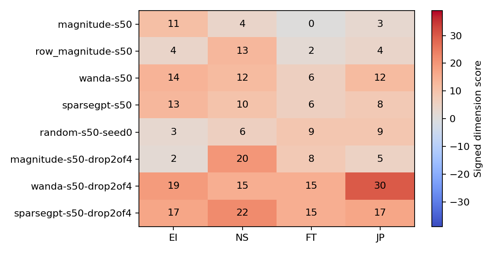

# 静态剪枝扩展：完整结果表

已验证 64/64 组。全部完成。

PPL 为固定 WikiText-2 test 短上下文子集诊断；一致率不是准确率，也不是真实人格保持率。
零分 `?` 表示该维度没有确定方向。首 token 不合法不等同于整段生成一定不合法；自由生成只有 6 个固定探针。

| 配置 | 类型 | EI/NS/FT/JP | 一致率(60) | PPL | 合法首 token | 选项总概率 | D 比例 |
|---|---|---|---:|---:|---:|---:|---:|
| dense-s00 | ENFJ | 5/13/5/15 | 100.0% | 12.97 | 100.0% | 1 | 21.7% |
| magnitude-s10 | EN?J | 9/6/0/9 | 86.7% | 13.04 | 100.0% | 1 | 20.0% |
| magnitude-s20 | ENFJ | 5/9/5/9 | 58.3% | 14.17 | 100.0% | 0.999999 | 8.3% |
| magnitude-s30 | ENFJ | 16/18/8/16 | 68.3% | 22.94 | 100.0% | 0.999988 | 13.3% |
| magnitude-s40 | ENFJ | 11/18/5/11 | 43.3% | 144.23 | 100.0% | 0.999902 | 16.7% |
| magnitude-s50 | EN?J | 11/4/0/3 | 18.3% | 311.73 | 98.3% | 0.908006 | 76.7% |
| magnitude-s60 | IST? | -3/-1/-2/0 | 11.7% | 5000.12 | 0.0% | 0.0716217 | 0.0% |
| magnitude-s70 | ENTJ | 2/1/-1/2 | 16.7% | 49855.78 | 0.0% | 0.00308411 | 55.0% |
| row_magnitude-s10 | ENFJ | 6/8/5/9 | 91.7% | 13.06 | 100.0% | 1 | 18.3% |
| row_magnitude-s20 | ENFJ | 10/18/6/8 | 70.0% | 14.45 | 100.0% | 0.999999 | 13.3% |
| row_magnitude-s30 | ENFJ | 12/16/7/14 | 53.3% | 23.60 | 100.0% | 0.999988 | 13.3% |
| row_magnitude-s40 | ENFJ | 10/16/4/8 | 45.0% | 92.60 | 100.0% | 0.99982 | 31.7% |
| row_magnitude-s50 | ENFJ | 4/13/2/4 | 23.3% | 298.59 | 98.3% | 0.975561 | 28.3% |
| row_magnitude-s60 | ENTJ | 2/6/-1/7 | 25.0% | 112480.16 | 0.0% | 0.00793361 | 1.7% |
| row_magnitude-s70 | ISTP | -1/-3/-3/-3 | 5.0% | 31916.14 | 96.7% | 0.300231 | 0.0% |
| wanda-s10 | ENFJ | 4/13/5/15 | 98.3% | 12.99 | 100.0% | 1 | 21.7% |
| wanda-s20 | ENFJ | 9/14/4/10 | 85.0% | 13.29 | 100.0% | 1 | 23.3% |
| wanda-s30 | ENFJ | 7/18/3/15 | 63.3% | 14.00 | 100.0% | 1 | 21.7% |
| wanda-s40 | ENFJ | 12/16/5/12 | 53.3% | 15.33 | 100.0% | 1 | 36.7% |
| wanda-s50 | ENFJ | 14/12/6/12 | 46.7% | 17.11 | 100.0% | 1 | 36.7% |
| wanda-s60 | ENFJ | 7/10/15/9 | 31.7% | 24.18 | 100.0% | 0.99969 | 13.3% |
| wanda-s70 | ENFJ | 6/6/9/6 | 28.3% | 105.69 | 0.0% | 0.0684759 | 0.0% |
| sparsegpt-s10 | ENFJ | 6/6/5/12 | 90.0% | 13.00 | 100.0% | 1 | 25.0% |
| sparsegpt-s20 | ENFJ | 7/14/8/20 | 70.0% | 13.28 | 100.0% | 1 | 18.3% |
| sparsegpt-s30 | ENFJ | 10/17/8/10 | 61.7% | 13.95 | 100.0% | 1 | 30.0% |
| sparsegpt-s40 | ENFJ | 10/14/2/13 | 48.3% | 14.79 | 100.0% | 0.999993 | 46.7% |
| sparsegpt-s50 | ENFJ | 13/10/6/8 | 20.0% | 17.12 | 100.0% | 0.999998 | 20.0% |
| sparsegpt-s60 | ENFJ | 10/18/10/13 | 31.7% | 21.14 | 100.0% | 0.999845 | 36.7% |
| sparsegpt-s70 | ENFJ | 6/6/9/6 | 28.3% | 34.31 | 51.7% | 0.381687 | 0.0% |
| random-s10-seed0 | ENFJ | 8/10/4/12 | 16.7% | 31.55 | 100.0% | 0.999998 | 1.7% |
| random-s10-seed1 | ENFJ | 5/8/4/7 | 33.3% | 34.65 | 100.0% | 0.999969 | 6.7% |
| random-s10-seed2 | ENFJ | 14/17/11/11 | 40.0% | 37.59 | 100.0% | 0.999976 | 10.0% |
| random-s30-seed0 | ENFJ | 4/8/5/3 | 28.3% | 25179.59 | 0.0% | 0.00294203 | 0.0% |
| random-s30-seed1 | ENFJ | 2/2/3/2 | 0.0% | 35856.40 | 0.0% | 0.00466503 | 0.0% |
| random-s30-seed2 | ?NFP | 0/2/3/-2 | 0.0% | 72625.35 | 0.0% | 0.025473 | 0.0% |
| random-s50-seed0 | ENFJ | 3/6/9/9 | 26.7% | 630070.73 | 0.0% | 0.0106182 | 6.7% |
| random-s50-seed1 | ENFJ | 2/2/3/2 | 0.0% | 20737.01 | 0.0% | 0.000983292 | 0.0% |
| random-s50-seed2 | ???? | 0/0/0/0 | 21.7% | 989189.34 | 0.0% | 0.000454908 | 100.0% |
| random-s70-seed0 | ENFJ | 6/6/9/6 | 28.3% | 218011.12 | 0.0% | 0.00263597 | 0.0% |
| random-s70-seed1 | ISTP | -2/-2/-3/-2 | 1.7% | 296394.16 | 0.0% | 0.000265743 | 0.0% |
| random-s70-seed2 | ENFJ | 6/6/9/6 | 28.3% | 137193.92 | 0.0% | 0.0551414 | 0.0% |
| magnitude-s25-drop1of4 | ENFJ | 11/14/5/6 | 36.7% | 20.79 | 100.0% | 0.999992 | 25.0% |
| magnitude-s50-drop2of4 | ENFJ | 2/20/8/5 | 31.7% | 1572.33 | 0.0% | 1.88427e-05 | 0.0% |
| magnitude-s75-drop3of4 | ISFJ | -7/-3/1/3 | 15.0% | 22859909197.35 | 0.0% | 0.000226239 | 40.0% |
| wanda-s25-drop1of4 | ENFJ | 15/14/2/13 | 55.0% | 14.97 | 100.0% | 0.999999 | 28.3% |
| wanda-s50-drop2of4 | ENFJ | 19/15/15/30 | 28.3% | 26.64 | 100.0% | 0.99992 | 1.7% |
| wanda-s75-drop3of4 | ENFJ | 6/6/9/6 | 28.3% | 5893.19 | 0.0% | 0.0349567 | 0.0% |
| sparsegpt-s25-drop1of4 | ENFJ | 8/8/6/7 | 31.7% | 14.57 | 100.0% | 1 | 36.7% |
| sparsegpt-s50-drop2of4 | ENFJ | 17/22/15/17 | 38.3% | 21.82 | 100.0% | 0.989773 | 11.7% |
| sparsegpt-s75-drop3of4 | ENFJ | 6/6/9/6 | 28.3% | 164.18 | 33.3% | 0.329706 | 0.0% |
| magnitude-s50-attention | ENFJ | 19/23/3/16 | 51.7% | 16.01 | 100.0% | 0.997348 | 0.0% |
| magnitude-s50-mlp | ENFJ | 11/4/10/9 | 16.7% | 48.10 | 98.3% | 0.985003 | 35.0% |
| magnitude-s50-early | ENFJ | 13/16/10/4 | 38.3% | 22.32 | 100.0% | 1 | 25.0% |
| magnitude-s50-middle | ENFJ | 6/12/4/18 | 50.0% | 14.58 | 100.0% | 0.999938 | 20.0% |
| magnitude-s50-late | ENTJ | 9/14/-3/21 | 55.0% | 245.22 | 100.0% | 0.999172 | 36.7% |
| wanda-s50-attention | ENFJ | 8/11/8/15 | 58.3% | 13.59 | 100.0% | 1 | 11.7% |
| wanda-s50-mlp | ENFJ | 15/14/9/14 | 51.7% | 16.82 | 100.0% | 1 | 23.3% |
| wanda-s50-early | ENFJ | 10/17/6/10 | 65.0% | 14.14 | 100.0% | 1 | 11.7% |
| wanda-s50-middle | ENFJ | 14/12/6/24 | 46.7% | 13.98 | 100.0% | 1 | 25.0% |
| wanda-s50-late | ENFJ | 11/5/6/8 | 56.7% | 15.74 | 100.0% | 0.999999 | 48.3% |
| wanda-s50-calib1 | ENFJ | 15/14/10/11 | 50.0% | 17.17 | 100.0% | 1 | 33.3% |
| wanda-s50-calib2 | ENFJ | 14/11/9/11 | 51.7% | 17.23 | 100.0% | 1 | 36.7% |
| sparsegpt-s50-calib1 | ENFJ | 8/8/6/4 | 36.7% | 17.26 | 100.0% | 0.999353 | 40.0% |
| sparsegpt-s50-calib2 | ENFJ | 14/17/11/14 | 26.7% | 17.25 | 100.0% | 0.999061 | 10.0% |

## 图表

逐题可审计分解见 `item_deltas.csv`，逐层和生成原文见 `analysis.json`。
常量回答对照见 `response_controls.json`：当前题目方向下，全选 A/B/C 是 ENFJ，全选 E/F/G 是 ISTP。
`soft_*` 是选项概率加权的期望分数；`balanced_*` 是正/负向题分别取均值再相减的事后敏感性分析。二者不替代原协议分数，也不是验证过的新量表。
随机方法曲线是种子均值，误差棒为掩码种子的最小–最大范围（完整结果为 3 个种子），不是置信区间。
局部 scope 消融的总删除参数不同，不能直接当等预算方法排名。
